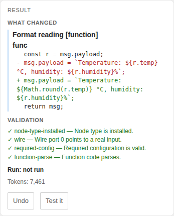

```
 ███████████ ████                           ███████████   ███  ████            █████
░░███░░░░░░█░░███                          ░░███░░░░░███ ░░░  ░░███           ░░███
 ░███   █ ░  ░███   ██████  █████ ███ █████ ░███    ░███ ████  ░███   ██████  ███████
 ░███████    ░███  ███░░███░░███ ░███░░███  ░██████████ ░░███  ░███  ███░░███░░░███░
 ░███░░░█    ░███ ░███ ░███ ░███ ░███ ░███  ░███░░░░░░   ░███  ░███ ░███ ░███  ░███
 ░███  ░     ░███ ░███ ░███ ░░███████████   ░███         ░███  ░███ ░███ ░███  ░███ ███
 █████       █████░░██████   ░░████░████    █████        █████ █████░░██████   ░░█████
░░░░░       ░░░░░  ░░░░░░     ░░░░ ░░░░    ░░░░░        ░░░░░ ░░░░░  ░░░░░░     ░░░░
```

<div align="center">

### AI assistance for Node-RED — for builders who want help without giving up control.

[](https://www.npmjs.com/package/@manny-est/node-red-flowpilot)
[](https://nodered.org/)
[](https://nodejs.org/)
[](#)

**[Watch the walkthrough (older UI)](https://github.com/manny-est/flowpilot/releases/download/v0.2.1/full-intro-demo.mp4)** · **[User Guide](USER-GUIDE.md)** · **[Project Overview](PROJECT-OVERVIEW.md)** · **[Report a Bug](https://github.com/manny-est/flowpilot/issues)**

</div>

---

FlowPilot is an AI assistant in the Node-RED editor sidebar. It works with
**Anthropic** models and **OpenAI-compatible** APIs, including OpenAI, LocalAI,
and Ollama. It reads your flows, answers questions about the real nodes, and
helps you make changes while keeping you in control.



## Table of contents

- [Design principles](#design-principles)
- [Privacy & data](#privacy--data)
- [Features](#features)
- [Requirements](#requirements)
- [Install](#install)
- [Provider setup](#provider-setup)
- [Examples](#examples)
- [Development status](#development-status)
- [Feedback](#feedback)

## Design principles

| Principle | What it means |
| --- | --- |
| **Reuse Node-RED** | FlowPilot uses Node-RED's selection, editor history, undo, wiring, and deploy behavior. |
| **User-initiated only** | FlowPilot sends requests only when you ask. Questions are read-only. |
| **Visible decisions** | Clear targeted changes run and are shown afterward with one-step **Undo**. Bigger or open-ended requests show a plan first, and risky operations ask before they run. |
| **Undo first** | A direct run is one Node-RED undo step, including its connected changes. |
| **Open architecture** | Use native Anthropic support or any OpenAI-compatible REST endpoint. |
| **Simple and lightweight** | The interface keeps the decision in the prompt, with **Auto**, a one-message **▾** choice, and **Send**. |

## Privacy & data

FlowPilot sends data to an AI provider **only when you trigger a request**. A
request may include selected nodes and wiring, attached Debug messages, and
recent conversation history.

Before sending, FlowPilot strips editor-internal fields and redacts values that
look like secrets such as credentials, tokens, API keys, and authorization
headers. Node-RED's separate credential store is never included. A warning
appears when context may still contain sensitive configuration or code.

Because flow contents leave Node-RED when you send a request, use a local or
private provider for sensitive or proprietary flows. See the [User
Guide](USER-GUIDE.md#privacy-and-safety) for details.

## Features

- 💬 **Questions with real context** — FlowPilot reads your flows and can quote
  the actual nodes and connections. Asking a question does not change them.
- ✨ **Simple Flow changes** — clear targeted changes run directly with **Auto**
  and finish with a result card and one-step **Undo**.
- 🧭 **Plan cards** — bigger or open-ended requests show a summary, steps, and
  risky operations before **Approve** runs them.
- ❓ **Target clarification** — ambiguous requests show **Which one?** with
  candidate nodes and their tab names.
- 🛡️ **Consent and safety gates** — deletes, deployments that include your own
  edits, and external side-effecting nodes ask with **Proceed** or **Skip this
  step**.
- ✅ **Validation and runtime proof** — writes are checked, and **Test it** can
  verify a flow with temporary FlowPilot test nodes that are cleaned up.
- ⏯️ **Auto, one-shot choices, and Restricted mode** — turn Auto off for a plan
  on every change, choose **Plan first** or **Just do it** for one message, or
  prevent deployment entirely with **Restricted mode**.
- 🗂️ **Saved prompts** — type `/` to fill a saved prompt or use a built-in
  command; choosing a prompt does not send it.
- 🪟 **Pop-out window** — use the same controls and cards in a separate window.
- 🧠 **Conversation memory** — continue a conversation and recall earlier
  conversations from the Flight log.

## Requirements

- Node-RED **4.x** and **5.x**, tested
- Node.js **16+**

## Install

In the Node-RED editor, open **Menu → Manage palette → Install**, search for
`@manny-est/node-red-flowpilot`, and click **Install**.

Or, from your Node-RED user directory:

```bash
cd ~/.node-red
npm install @manny-est/node-red-flowpilot
node-red
```

> **Restart required.** Restart Node-RED, or the container, after installing or updating. A browser refresh alone does not reload the cached editor UI.

### Docker / container setup

Install into the mounted Node-RED user directory. If it is `/data`, the
package should be at:

```text
/data/node_modules/@manny-est/node-red-flowpilot
```

Restart the Node-RED container or process after updating package files.

### Where FlowPilot stores its data

FlowPilot stores its settings and logs under
`<node-red-userDir>/flowpilot/`:

| Path | Contents |
| --- | --- |
| `settings.json` | Provider configuration, saved prompts, and behavior settings |
| `audit.log` | A log of generate, modify, document, and related actions |
| `chats/` | Lightweight per-session conversation logs |
| `backups/` | Pre-change backups |

## Provider setup

Open the FlowPilot sidebar, click the gear icon, add a provider, and click
**Pre-flight check** to save and verify it.

### Anthropic (Claude models)

| Field | Value |
| --- | --- |
| Provider | `Anthropic` |
| Provider name | `Claude`, or any label |
| Base URL | Leave blank for `api.anthropic.com` |
| API key | Your Anthropic API key |
| Model | A model name, or **Refresh models** |

### OpenAI-compatible APIs

| Field | Example |
| --- | --- |
| Provider | `OpenAI-compatible` |
| Provider name | `LocalAI`, or any label |
| Base URL | `http://localhost:8080` |
| API key | Blank unless required by the service |
| Model | Your model name |
| Temperature | Leave empty to use the model's default |

When Node-RED runs in Docker, `localhost` refers to the Node-RED container.
Use the provider's container name, Docker network alias, or host IP instead,
for example `http://localai:8080` or `http://172.17.0.1:8080`.

## Examples

The `examples/` folder is available from **Import → Examples → FlowPilot** in
the editor. It includes a Getting Started flow and a Dad Joke Demo. See the
[User Guide](USER-GUIDE.md#examples) for details.

## Development status

Version 0.7.0 introduces Simple Flow: clear changes run directly and finish
with a result card and one-step **Undo**, larger requests show a plan card
first, and risky operations ask before they run. See the
[changelog](CHANGELOG.md) for release details.

## Feedback

Found a bug or have a feature request? Please [open an issue](https://github.com/manny-est/flowpilot/issues).

---

<div align="center">
<sub>Built for Node-RED. Provider-agnostic by design.</sub>
</div>
