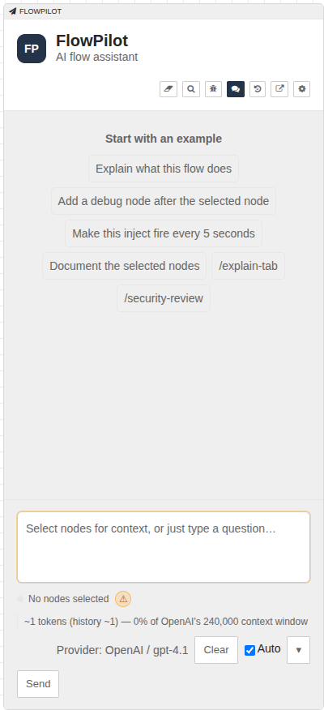
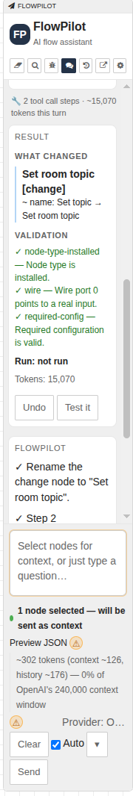
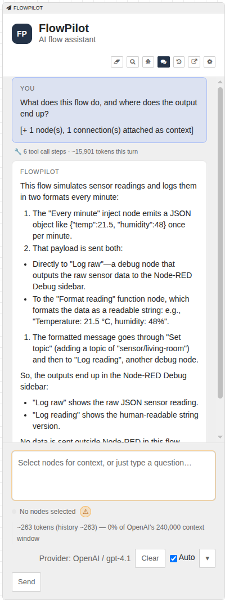
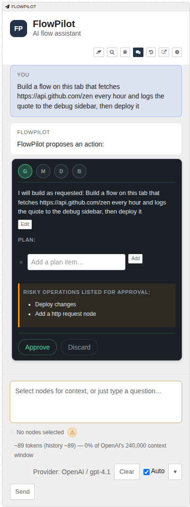
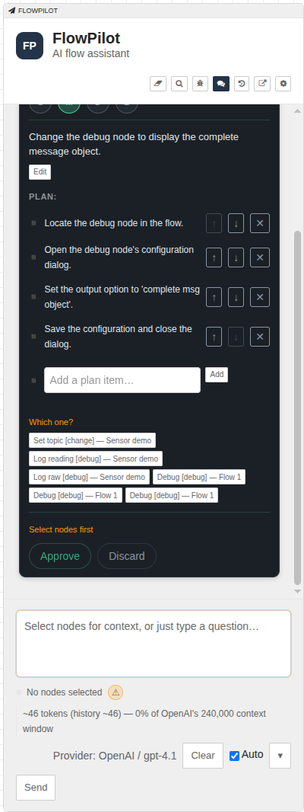
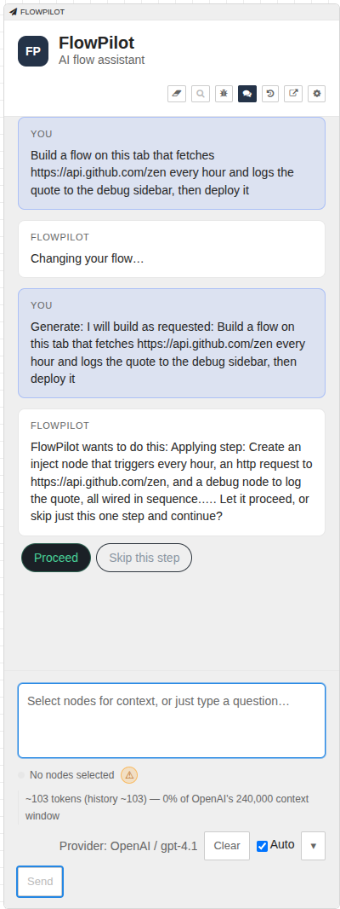
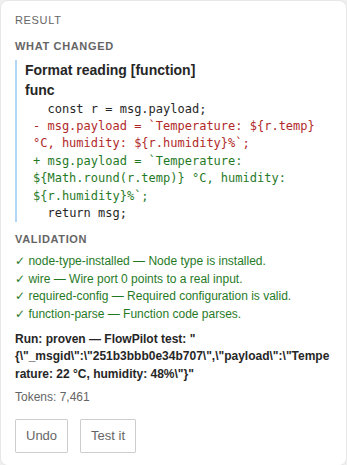
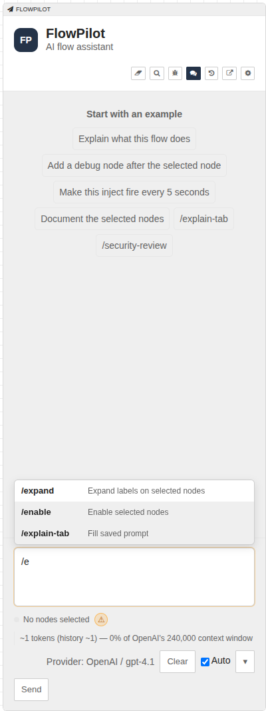
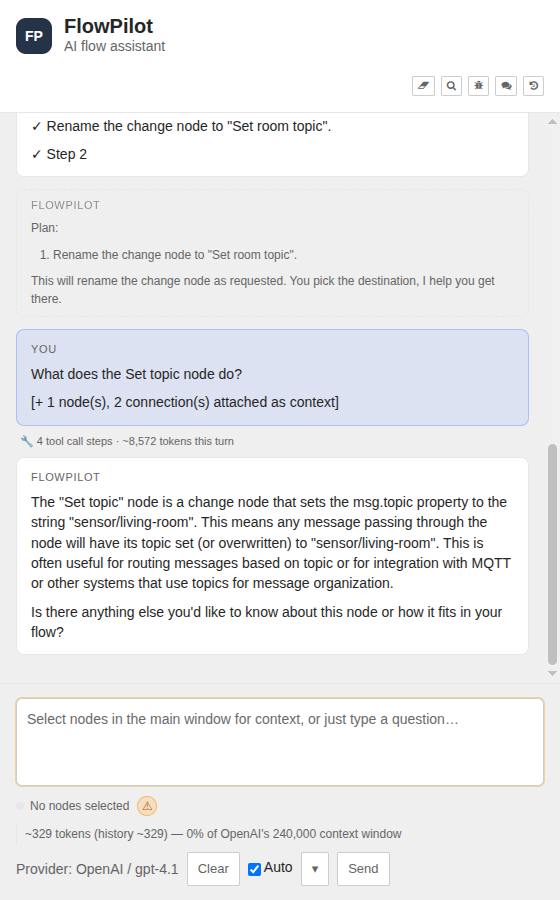
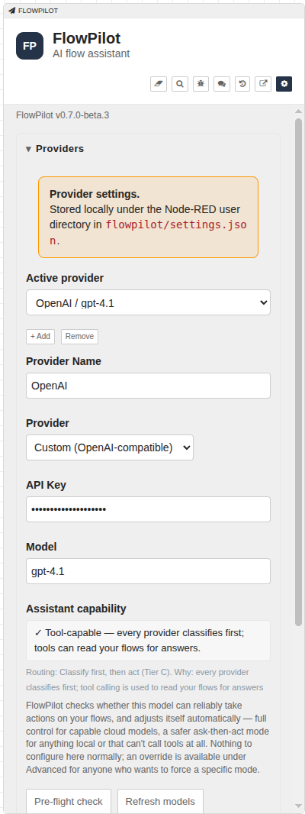

# FlowPilot — User Guide

FlowPilot is an AI assistant for building and understanding Node-RED flows. It
reads the flows you point it at, answers questions about the real nodes, and
helps you make changes while keeping the important decisions visible.

▶ **[Watch a full walkthrough (older UI)](https://github.com/manny-est/flowpilot/releases/download/v0.2.1/full-intro-demo.mp4)** (MP4) — this video shows the older FlowPilot interface, not the 0.7.0 Simple Flow UI.

## Table of contents

- [Getting Started](#getting-started)
- [The sidebar at a glance](#the-sidebar-at-a-glance)
- [Asking questions](#asking-questions)
- [Making a change](#making-a-change)
- [What asks first](#what-asks-first)
- [Auto, ▾ and Restricted mode](#auto--and-restricted-mode)
- [Checks and runtime proof](#checks-and-runtime-proof)
- [Messages while it is working](#messages-while-it-is-working)
- [Saved prompts and slash commands](#saved-prompts-and-slash-commands)
- [Pop-out window](#pop-out-window)
- [Slow models and errors](#slow-models-and-errors)
- [Models without tool calling](#models-without-tool-calling)
- [Settings reference](#settings-reference)
- [Provider setup](#provider-setup)
- [Privacy and safety](#privacy-and-safety)
- [Recall and Flight log](#recall-and-flight-log)
- [Examples](#examples)
- [Bug reports and feature requests](#bug-reports-and-feature-requests)

## Getting Started

### Install from the Palette

In the Node-RED editor, open **Menu → Manage palette → Install**, search for
`@manny-est/node-red-flowpilot`, and click **Install**.

### Install via npm

From your Node-RED user directory:

```bash
cd ~/.node-red
npm install @manny-est/node-red-flowpilot
node-red
```

### Restart Node-RED

Restart Node-RED, or restart the container, after installing or updating
FlowPilot. A browser refresh is not enough because the editor UI is assembled
and cached by the Node-RED server.

### Find the FlowPilot tab

Open the FlowPilot sidebar tab. It is the paper-plane tab, usually grouped with
Info and Debug on the right side of the editor. This part of Node-RED has not
changed since the older release assets:


You can also watch [a short clip of finding the FlowPilot tab](https://github.com/manny-est/flowpilot/releases/download/v0.2.1/finding-flowpilot.mp4).

On first launch, open Settings, add a provider, and run **Pre-flight check**.
Then return to the chat panel and try one of the example prompts.

## The sidebar at a glance

The sidebar header has these controls:

- The eraser starts a fresh conversation and clears its memory.
- The magnifying glass opens Recall, which searches earlier conversations.
- The bug icon opens recent Node-RED Debug sidebar output so you can attach a
  message as context.
- The chat icon returns to the conversation.
- The clock opens the Flight log of saved conversations.
- The pop-out icon opens the same FlowPilot controls in a separate window.
- The gear opens Settings.

With no conversation, FlowPilot shows example prompts. They fill the prompt box
when clicked; they do not send anything. The prompt box accepts a question or
an instruction. Select nodes in the main editor when you want to target them,
or name a node in your request.

Below the prompt box, the status line shows the current selection, context-size
warnings, possible sensitive context, attached Debug messages, and the active
provider. **Preview JSON** can show the sanitized node context that would be
sent. At the right are **Clear**, **Auto**, the **▾** menu, and **Send**.

**Auto** is on by default. The **▾** menu offers a one-message choice of
**Plan first**, **Just do it**, or **Normal**. The selected one-shot choice stays
visible until that message is sent.



FlowPilot also works at Node-RED's 180 px minimum sidebar width:



## Asking questions

Type a question and press **Send**. FlowPilot first reads the relevant flows,
including the nodes and connections it can inspect. Its answer can quote your
real node names, properties, or function code instead of guessing from a
generic description.

Questions are read-only. Asking what a flow does, why a node is connected, or
how to troubleshoot a Debug message does not change the canvas or deploy
anything.



If a request is too unclear to carry out safely, FlowPilot asks a question. If
the target is a change and more than one node could match, it uses the
**Which one?** picker described below.

## Making a change

Describe the result you want in plain language. Select a node for context when
that is easiest, or name it in the request.

### A clear, targeted change

With **Auto** on, a clear change to a selected or named node normally runs
straight away. Examples include renaming a node, fixing a function, or making
an inject node fire every five seconds.

After the write, FlowPilot shows a result card. It includes:

- the changes made to each node;
- a line diff for function code;
- the validation checks;
- whether a runtime check ran and what it observed;
- the tokens used; and
- **Undo**, which reverses the whole run in one step.


The result card reports the editor change. If you also want FlowPilot to
deploy and test the runtime, ask it to test the flow or use **Test it** when
that control is available.

### A bigger or open-ended request

Requests such as “build me a flow that…” or a multi-part change show a plan
card first. The card contains a summary, the steps FlowPilot intends to take,
and risky operations listed up front. Review it and press **Approve** to run
the plan. An operation that was not listed can still ask for consent during
the run.



### “Which one?”

When a name or description matches several nodes, FlowPilot does not guess. It
shows **Which one?** and lists candidates with their node names, types, and tab
names. Pick the intended candidate, then FlowPilot continues with that target.



## What asks first

FlowPilot asks before operations that can have a larger effect. The prompt is
shown as “FlowPilot wants to do this” with **Proceed** and **Skip this step**.

The normal asks-first cases are:

- deleting nodes;
- deploying when the deployment would also include undeployed edits you made
  yourself; and
- creating, changing, or triggering nodes that reach outside Node-RED, such
  as HTTP request, MQTT, exec, file, e-mail, TCP/UDP, WebSocket, or serial
  nodes.



Every step that an approved plan listed as risky is covered by that approval.
Other risky work still asks when FlowPilot reaches it. **Skip this step** lets
the run continue without that operation; the result explains what was skipped.

### “This turned out bigger than expected”

FlowPilot also pauses if a run starts changing nodes outside the target you
gave it, or touches more nodes than expected. You can keep going with the
expanded change or undo the run. The **Diff-gate pause above (changed nodes)**
setting controls the default size threshold; it is 5 changed nodes.

## Auto, ▾ and Restricted mode

- **Auto on** lets clear, safely targeted changes run directly and sends bigger
  requests through a plan card.
- Turn **Auto** off to get a plan card for every change.
- The **▾** menu sets **Plan first** or **Just do it** for the next message
  only. **Normal** returns to the ordinary Simple Flow decision for that
  message.
- **Restricted mode**, in Settings, never deploys. Every change gets a plan
  card and you deploy the flow yourself.

## Checks and runtime proof

FlowPilot validates after every write. Checks include whether node types are
installed, whether wires point to real nodes, whether required settings are
filled in, and whether Function code parses. Function code is checked, never
run as part of syntax validation. If a check finds a fixable problem,
FlowPilot can make another attempt before stopping.

For a runtime proof, FlowPilot adds its own temporary Debug nodes named
“FlowPilot test” next to the relevant output, deploys, triggers the flow, and
reads the messages they receive. It then removes those nodes and deploys again
so they are not left in the flow. **Test it** on a result card runs the same
proof on demand.

- **Run: proven — …** means FlowPilot observed output from its own test node
  and quotes the observed value.
- **Run: not provable here — …** means it could not obtain qualifying runtime
  evidence; the card gives the reason. It is not a claim that the flow is
  broken.



The temporary test messages also appear in Node-RED's Debug sidebar while the
proof runs. This is a known limitation. If a tab closes or a run crashes and
leaves test nodes behind, FlowPilot removes its own leftover test nodes when
the editor loads and shows a notice. Restricted mode adds no test nodes and
never deploys.

## Messages while it is working

While FlowPilot is working, a new message is queued rather than starting a
second request. At the next safe step it asks what to do:

- **Stop and do this instead** stops the current run at that boundary. Changes
  already made stay on the canvas, and the new message becomes the next work.
- **Do it after** keeps the current run going and offers the new message after
  it finishes.

Only one message can be queued at a time. The prompt box indicates when one is
waiting.

## Saved prompts and slash commands

Type `/` in the prompt box to see the built-in commands and your saved prompts.
Selecting a saved prompt fills the box without sending it. Add, edit, and
delete saved prompts in **Settings → Behavior → Saved prompts**.



The current built-in commands are:

| Command | What it does |
| --- | --- |
| `/help` | Shows the built-in briefing. |
| `/generate` | Arms Generate for the next send. Extra text stays in the prompt box. |
| `/modify` | Arms Modify for the next send. |
| `/document` | Arms Document for the next send. |
| `/build` | Arms the deploy-verify build loop for the next send. |
| `/plan` | Sets the next send to **Plan first**. |
| `/query` or `/chat` | Returns to an ordinary chat question. |
| `/clear` | Starts a fresh conversation and clears its memory. |
| `/history` | Opens the Flight log. |
| `/settings` | Opens Settings. |
| `/compact` | Hides labels on the selected nodes. |
| `/expand` | Restores labels on the selected nodes. |
| `/disable` | Disables the selected nodes. |
| `/enable` | Re-enables the selected nodes. |
| `/refresh` | Re-renders the conversation from FlowPilot's in-memory record store. |
| `/debug` | Turns debug logging on or off. |
| `/summarize` | Summarizes older chat history while keeping the latest two exchanges. |
| `/demo` | Fills the prompt box with a sample dad-joke flow request. |
| `/bug` | Shows the bug-report link and reporting details. |
| `/feedback` | Shows the feature-request and feedback links. |
| `/beta` | Shows beta install and revert instructions. |

Commands are handled locally where possible. For example, `/compact`,
`/expand`, `/disable`, and `/enable` use Node-RED's own editor actions and can
be undone with Node-RED undo. A command with extra text leaves that text in the
box for you to review before sending.

Custom intents from earlier FlowPilot versions are converted automatically to
saved prompts the first time this version loads. FlowPilot shows a one-time
notice; the prompt text is retained.

## Pop-out window

Click the pop-out icon in the sidebar header to open FlowPilot in its own
window. It has the same prompt box, **Auto**, **▾**, **Send**, slash menu,
questions, consent controls, plans, result cards, and settings behavior as the
sidebar. This is useful when the Node-RED canvas needs the main window. The
conversation remains shared with the sidebar.



## Slow models and errors

Local models can take a minute or more per step. FlowPilot keeps the proxy
connection open for long turns, and the status line adds a reminder when a
local run has been waiting for a while. If a local model regularly times out,
raise **Settings → Behavior → Request timeout** or use a faster model.

Errors are shown as plain sentences. Common messages mean:

- **The model took too long and the connection was closed by a proxy (504).**
  The proxy timed out; try again, use a faster model, or raise the relevant
  proxy limit.
- **Couldn't reach the server behind the proxy (502).** The proxy could not
  reach the server behind it.
- **Authentication failed (401).** Sign in again or check the provider
  credentials.
- **You don't have permission to use FlowPilot (403).** The current account or
  Node-RED permissions do not allow the request.
- **Request timed out.** The request-specific timeout expired; try again or
  use a faster model.
- **Couldn't reach FlowPilot.** Check the Node-RED connection and try again.

Other provider errors appear as a short status and message. Raw proxy or error
page HTML is not shown in the chat.

## Models without tool calling

Models that cannot reliably call tools keep the older review-and-apply flow.
FlowPilot still classifies the request and shows the proposed result for you to
review before applying it. The Simple Flow cards, consent rules, and runtime
proof apply to models that support the current tool-calling path.

## Settings reference

Open Settings with the gear icon. These are the current controls, grouped as
they appear in the panel:

| Panel group | Controls |
| --- | --- |
| **Providers** | Active provider, provider name and preset, API key, model, assistant capability, **Pre-flight check**, **Refresh models**, and the **Diagnostics** options for base URL, provider-specific options, context window, temperature, and capability override. |
| **Behavior** | **Restricted mode**, System Prompt, Personality, conversation memory, streamed replies, request timeout, update checks, per-step and per-turn token limits, build-loop attempt limit, and saved prompts. |
| **Context & Safety** | Context-size warning thresholds, **Diff-gate pause above (changed nodes)**, recurring-warning display, secret-shaped-value redaction, and Debug mode. |



## Provider setup

Open Settings, add a provider, and choose **Anthropic** or
**OpenAI-compatible**. FlowPilot supports Anthropic models and compatible APIs
such as OpenAI, LocalAI, and Ollama.

### Anthropic (Claude models)

| Field | Value |
| --- | --- |
| Provider | **Anthropic** |
| Provider name | `Claude`, or any label |
| Base URL | Leave blank to use `api.anthropic.com` |
| API key | Your Anthropic API key |
| Model | A model name, or use **Refresh models** |

### OpenAI-compatible providers

| Field | Example |
| --- | --- |
| Provider | **OpenAI-compatible** |
| Provider name | `LocalAI`, or any label |
| Base URL | `http://localhost:8080` for a local service |
| API key | Blank unless the service requires one |
| Model | The model name used by the service |
| Temperature | `0.2` is a focused default |

Click **Pre-flight check** to save the provider and test it. The capability
readout tells you whether the model can reliably call tools.

### Docker and container notes

Install FlowPilot into the mounted Node-RED user directory. If that directory
is `/data`, the package should be under:

```text
/data/node_modules/@manny-est/node-red-flowpilot
```

Restart the Node-RED container after installing or updating the package.
Inside Docker, `localhost` means the Node-RED container. For a provider on the
host or another container, use its container name, network alias, or host IP,
for example `http://localai:8080` or `http://172.17.0.1:8080`.

## Privacy and safety

FlowPilot sends data only when you trigger a request. It does not work in the
background. A request can include the selected nodes and wiring, attached
Debug messages, and recent conversation history.

Before sending, FlowPilot strips editor-internal fields and redacts values that
look like passwords, tokens, API keys, or authorization headers. Node-RED's
separate credential store is never included. A warning icon appears when the
context may still contain sensitive configuration or code. Review it before
sending, especially to a cloud provider. A local or private provider such as
LocalAI or Ollama is recommended for sensitive flows.

You can inspect the sanitized context with **Preview JSON**. The redaction
opt-out is in **Settings → Context & Safety** and requires typing `disable
redaction`; use it only when you understand the risk.

## Recall and Flight log

**Recall** searches the text in the prompt box across earlier conversations and
shows matching exchanges. It does not send a new request automatically. Use
**Use this** on a result when you want that exchange added to the current
conversation's context.

The **Flight log** lists saved conversations. Click one to load it and continue
its memory, or delete a transcript when you no longer need it.

## Examples

The `examples/` folder is available from **Import → Examples → FlowPilot** in
the editor:

- **Getting Started** is a small inject → function → debug flow for trying
  questions and targeted changes.
- **Dad Joke Demo** is a working example of the request inserted by `/demo`.

## Bug reports and feature requests

Open an issue at <https://github.com/manny-est/flowpilot/issues>. Include your
Node-RED and FlowPilot versions, provider and model (not the API key), steps to
reproduce, expected versus actual behavior, and useful Node-RED or browser log
details.
